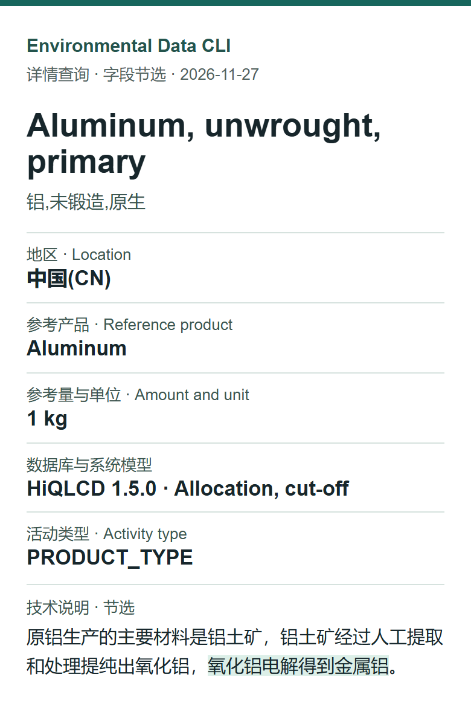

# Primary aluminium production in China

Ask Environmental Data:

> Which datasets are available for primary aluminium production in China?

After [installation and login](INSTALLATION.md), use the trusted absolute path
of the installed executable to search by product and geography. Replace the
example path with that path:

```bash
/absolute/path/to/environmental-data search 'aluminum' --location CN --json
```

## Example dataset

A supplied detail-query field excerpt from 27 November 2026 shows **Aluminum,
unwrought, primary** in HiQLCD 1.5.0, Allocation, cut-off. Its location is China
(CN), its reference product is Aluminum, and its reference amount is 1 kg. The
activity type is `PRODUCT_TYPE`. The technology excerpt describes producing
aluminium metal by electrolysis of alumina extracted from bauxite.



This production-process evidence distinguishes the record from a similarly named
market or supply mix. The excerpt does not contain a dataset key or record link;
identify the record in search results using the fields shown and check its
technology description and geography. Use the exact returned key with `lookup`
to inspect details and follow the returned web link for the record. Results and
access depend on the available sources and account permissions.
